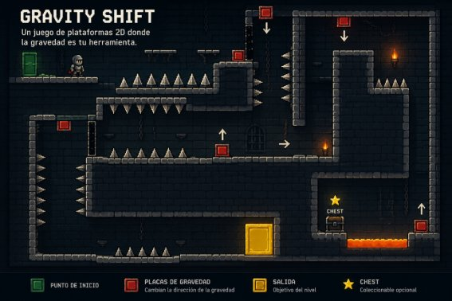
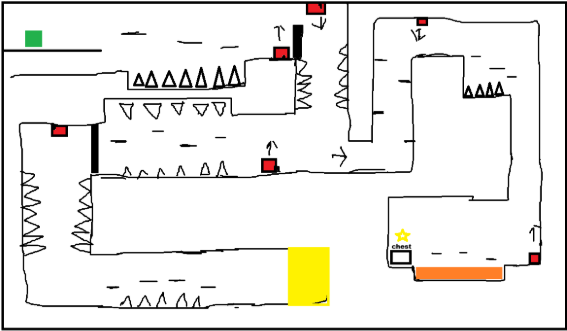

**GAME DESIGN DOCUMENT**

**Nombre del Juego**

**Gravity Shift**

**Versión:** 0.0.1

**Fecha de actualización:** 19/7/2026

**Ficha del Grupo**

|**Apellido y Nombre Completo**|**Función dentro del grupo**|
| :- | :- |
|Lautaro Oldani|Game Designer / Level Designer / Programmer|

1. **High Concept y Visión Inicia**

Desarrollar un videojuego de plataformas 2D de precisión basado en la manipulación dinámica de la gravedad en cuatro direcciones (arriba, abajo, izquierda y derecha). El objetivo es ofrecer una experiencia de diseño interconectado donde el jugador no solo debe superar obstáculos y enemigos, sino también gestionar estratégicamente recursos limitados —como los cambios de gravedad restringidos por zonas y los bloqueos de movimiento horizontal— para resolver puzles espaciales y encontrar la ruta de salida.

   **Concept art generado durante la etapa de preproducción que representa la ambientación y el estilo visual propuesto para Gravity Shift.**

## **2. Estructura Core del Proyecto**
**2.1 Objetivo del Proyecto**\

Consolidar el desarrollo de Gravity Shift, un plataformas 2D donde la manipulación de la gravedad en tiempo real es la herramienta central de navegación y resolución de puzles dentro de un entorno de mazmorra interconectado.\

**2.2 Diseño e Investigación\
Definición de la idea**

Definición de la idea: Gravity Shift sitúa al jugador en el rol de un caballero atrapado en una antigua mazmorra. A diferencia de un sistema estático, el jugador posee control directo sobre la orientación de la gravedad (ejes vertical y horizontal), debiendo sortear abismos, enemigos y zonas con reglas modificadas.\

**Género**

- Plataformas 2D 
- Puzzle 
- Precisión 

**Referencias**

- **VVVVVV** → Cambio de gravedad. 
- **Celeste** → Diseño de niveles y progresión. 
- **Portal 2** → Introducción gradual de una mecánica. 

**Público objetivo**

Gravity Shift está orientado a jugadores de PC que disfrutan los juegos de plataformas y resolución de desafíos. Está dirigido principalmente a adolescentes y adultos jóvenes interesados en experiencias donde el diseño de niveles y una mecánica innovadora sean el principal atractivo.

**Mecánicas principales actualizadas:**

Movimiento lateral y salto adaptados a la gravedad actual.

Cambio de gravedad direccional en tiempo real (teclas de control vertical y horizontal).

Zonas de gravedad restringida (límite de cambios permitidos antes de reiniciar al último checkpoint).

Áreas de bloqueo de movimiento horizontal (desactivación de ciertas direcciones de gravedad según la zona).

Sistema de checkpoints e interacción con objetos físicos (cajas, enemigos).

Exploración de niveles ramificados e interconectados.

**2.3 Concepto del Juego**

El jugador despierta dentro de una antigua mazmorra sin conocer cómo llegó allí. Para escapar deberá atravesar distintas salas repletas de obstáculos utilizando placas que alteran la gravedad. A medida que avance, los niveles introducirán nuevos desafíos y combinaciones de gravedad que pondrán a prueba la capacidad del jugador para adaptarse al entorno.

**2.4 Premisas del Videojuego**

- El cambio de gravedad será la mecánica principal del juego. 
- El diseño de niveles estará construido alrededor de esta mecánica. 
- El jugador deberá utilizar obligatoriamente las placas para avanzar. 
- La dificultad aumentará progresivamente mediante nuevas combinaciones de obstáculos y cambios de gravedad. 
- El combate no será el eje principal de la experiencia.** 

**2.5 Condiciones del Desarrollo**

- Motor gráfico: Godot Engine. 
- Lenguaje: GDScript. 
- Desarrollo individual. 
- Control de versiones mediante Git. 
- Assets gratuitos. 
- Tiempo estimado de desarrollo: cinco meses. 

**2.6 Alcance del Proyecto**

El proyecto evoluciona de un diseño puramente lineal a una estructura de niveles interconectados y ramificados (estilo mini-metroidvania), donde el jugador debe explorar distintas zonas, resolver puzles espaciales bajo restricciones específicas y volver sobre sus pasos para avanzar.

**Primera versión: Prototipo funcional**

**El prototipo incluirá:**

- Movimiento básico del caballero. 
- Sistema de cambio de gravedad. 
- Placas rojas para cambiar la gravedad entre arriba y abajo. 
- Placas azules para cambiar la gravedad entre izquierda y derecha. 
- Plataformas y obstáculos. 
- Interacción entre el personaje y las diferentes orientaciones de gravedad. 
- Un nivel de prueba compuesto por distintas secciones para experimentar con la mecánica. 
- Una condición de finalización del nivel de prueba. 

El nivel de prueba no formará parte necesariamente de los niveles finales del juego. Su función será permitir comprobar el funcionamiento de la mecánica principal y evaluar las posibilidades de diseño de niveles antes de comenzar el desarrollo de los niveles definitivos.

**Versión final prevista**

Una vez validada la mecánica principal, se desarrollarán los niveles definitivos del juego. El alcance previsto incluye:

- Aproximadamente cinco niveles. 
- Diseño de niveles basado en la utilización de las placas de gravedad. 
- Cofres que contienen las llaves necesarias para avanzar. 
- Barreras que bloquean el acceso a determinadas zonas. 
- Obstáculos y peligros. 
- Menú principal. 
- Pantallas de victoria y derrota. 
- Música y efectos de sonido. 
- Mejoras visuales y de ambientación. 

El proyecto se centrará principalmente en la mecánica de cambio de gravedad y en el diseño de niveles, evitando incorporar sistemas secundarios que aumenten innecesariamente el alcance del desarrollo.

# 3\. Diseño Detallado del Juego
**3.1 Elementos del Juego**\

|**Elemento**|**Tipo**|**Descripción**|
| :- | :- | :- |
|Caballero|Personaje|Personaje controlado por el jugador. Capaz de rotar su orientación física según la gravedad activa para escapar de la mazmorra.|
|Zonas de gravedad restringida|Mecánica|Áreas específicas donde el jugador cuenta con un número máximo de cambios de gravedad permitidos antes de reiniciar al checkpoint.|
|Zonas de bloqueo|Mecánica|Áreas especiales que desactivan temporalmente ciertos inputs o ejes de gravedad (como el movimiento horizontal).|
|Checkpoints|Escenario|Puntos de control que actualizan la posición de reaparición del jugador tras morir.|
|Caja|Entidad|Objeto rígido interactivo que reacciona a la gravedad global y puede ser desplazado por el jugador.|
|Enemigo|Entidad|Peligro móvil dentro del escenario que provoca la muerte inmediata al entrar en contacto con el jugador.|
|Obstáculos|Escenario|Peligros fijos que dificultan el avance, como pinchos o vacíos mortales.|
|Salida|Objetivo|Punto final del nivel al que se accede tras superar todas las restricciones de la zona.|

**3.2 Reglas**

|**Regla**|**Descripción**|
| :- | :- |
|Inicio del nivel|El jugador comienza cada nivel en un punto de inicio predeterminado (checkpoint inicial) dentro de la mazmorra.|
|Movimiento y gravedad|El jugador puede desplazarse y saltar, alterando la dirección de la gravedad (arriba, abajo, izquierda y derecha) en tiempo real mediante comandos asignados.|
|Restricción por zona|Al ingresar a ciertas zonas, el contador de cambios de gravedad se limita. Si se agotan los intentos permitidos, el jugador muere y reaparece en el checkpoint.|
|Bloqueo de inputs|Algunas salas restringen específicamente el cambio de gravedad en el eje horizontal para forzar soluciones lógicas concretas.|
|Interacción con objetos|Las cajas se desplazan y reaccionan de manera coherente según la orientación actual de la gravedad global del nivel.|
|Obstáculos y enemigos|Tocar un enemigo, un obstáculo peligroso (como pinchos) o caer al vacío provoca la muerte instantánea del jugador.|
|Sistema de reaparición|Al morir, el jugador reaparece automáticamente en el último checkpoint registrado y las cajas se restablecen a su posición original.|
|Victoria|El nivel se completa cuando el jugador logra atravesar la salida tras superar todos los puzles espaciales de la mazmorra.|

**3.3 Descripción de una sesión de juego**

El jugador inicia el nivel controlando al caballero en la entrada de la mazmorra. A medida que avanza, deberá superar plataformas y obstáculos utilizando las placas para cambiar la gravedad. Durante el recorrido encontrará un cofre que contiene la llave necesaria para desbloquear la barrera que protege la salida. Una vez obtenida la llave y abierta la barrera, podrá llegar a la salida y completar el nivel.\

**3.4 Estética y Experiencia del Jugador**

Gravity Shift busca transmitir una sensación de exploración, desafío y superación. A medida que el jugador avanza por la mazmorra, deberá observar cuidadosamente el entorno y utilizar la mecánica de cambio de gravedad para resolver los distintos desafíos. La dificultad aumentará de forma progresiva, incentivando el aprendizaje constante y la satisfacción de superar cada nivel.\

**Estética visual**

- Ambientación medieval. 
- Mazmorra antigua. 
- Iluminación tenue. 
- Plataformas de piedra. 
- Placas de gravedad con colores llamativos para facilitar su identificación. 

**Experiencia buscada**

- Curiosidad. 
- Desafío. 
- Satisfacción al resolver cada nivel. 
- Aprendizaje progresivo de la mecánica

#
# 4\. Arte, Audio y Bocetos
**Bocetos de Pantalla / UI**\
Boceto del primer nivel donde se representa la distribución aproximada de plataformas, placas de gravedad, obstáculos, cofre, barrera y salida.\

****

**Estilo Visual y Sonoro**

Visual:

- Pixel Art 2D. 
- Ambientación medieval. 
- Mazmorras de piedra. 
- Colores oscuros con elementos importantes resaltados mediante colores vivos (placas, llaves y salida). 

Sonoro:

- Música ambiental de fantasía. 
- Efectos para: 
  - salto; 
  - cambio de gravedad; 
  - apertura del cofre; 
  - obtención de la llave; 
  - apertura de la barrera; 
  - completar el nivel.

